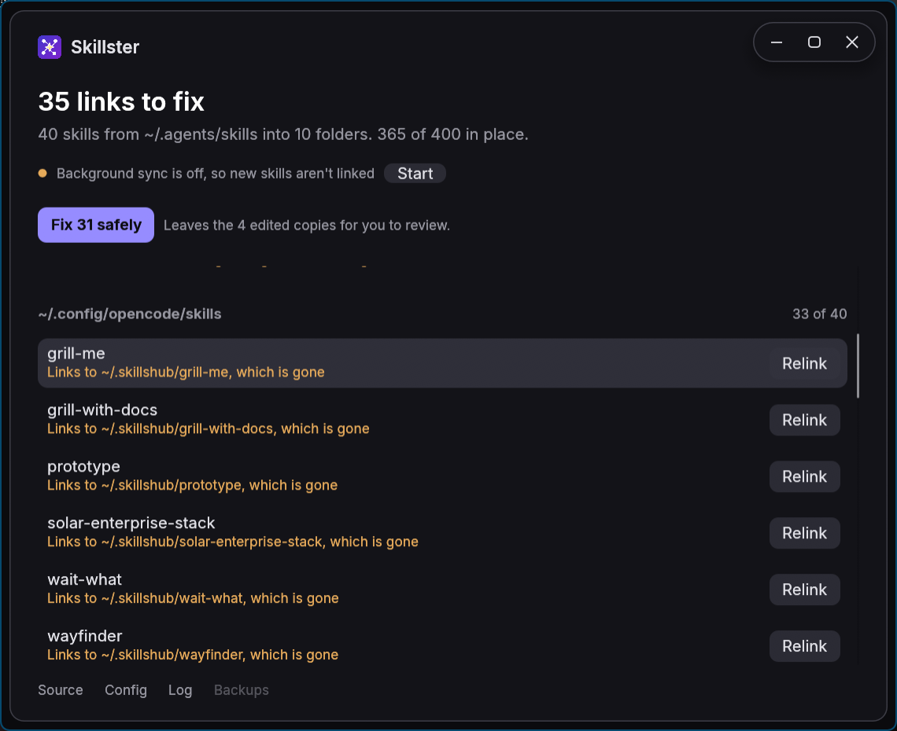

<p align="center"></p>

<h1 align="center">Skillster</h1>

Keeps every skill in one source folder (e.g. `~/.agents/skills`) linked into any number of target folders (e.g. `~/.claude/skills`), the way the `skills` CLI links them: junctions on Windows, symlinks on Linux and macOS. Runs in the background, syncs on every change to the source and rescans every 60 s.

- New skill in the source → link created in every target.
- Skill removed → its link is removed. Only links that point into the source are ever removed; real folders and other links are left alone (and logged once as `skipped`).
- One instance at a time.

The Skillster window shows what the background process had to leave alone, folder by folder, and fixes it:

- **Not linked yet**: links it now.
- **A copy, identical to the source**: replaces it with a link.
- **Links elsewhere** (often to a folder another tool has since deleted): points it at the source.
- **An edited copy**: lists the files that differ, with a diff of each, so you can decide. Replacing it is one click.

Copies are never deleted: they are moved into a `backups` folder next to the log first. **Fix safely** does everything except the edited copies in one go. The window also says whether background sync is running, and can start it.

<p align="center"></p>

Works on Windows, Linux and macOS, on x64 and ARM64.

## Install

**Windows** (PowerShell):

```powershell
irm https://github.com/alexcrisan1611/skillster/releases/latest/download/install.ps1 | iex
```

**Linux / macOS**:

```sh
curl -fsSL https://github.com/alexcrisan1611/skillster/releases/latest/download/install.sh | sh
```

The installer finds the `skills` folders on your computer and lets you pick, with arrow keys, the source and (with space) the targets; folders that already link to the source come ticked, and you can type other paths. On Windows it asks [Everything](https://www.voidtools.com/) (1.4 or 1.5) if it is running, which takes a moment; otherwise, and on Linux and macOS, it searches your home folder.

Only folders worth syncing are offered: a tool's own skills folder (`~/.claude/skills`, `~/.gemini/antigravity/skills`, `%APPDATA%\<app>\skills`, `~/.config/<app>/skills`) and standalone collections that hold skills (`~/Projects/my-skills/skills`). Plugin and marketplace caches, editor extensions, packages, virtualenvs, temp folders, backups, worktrees and projects' own `.claude/skills` are left out.

It then writes the config, installs `skillster`, `skillsterd` and the window `skillster-ui`, adds Skillster to your applications, and starts `skillsterd` now and at every login:

| | Installed to | Window, in your applications | Starts at login via | Config | Log and backups |
|---|---|---|---|---|---|
| Windows | `%LOCALAPPDATA%\Programs\skillster` | Start Menu | `HKCU\…\Run\skillster` | `%APPDATA%\skillster\config.toml` | `%LOCALAPPDATA%\skillster` |
| Linux | `~/.local/bin` | `~/.local/share/applications/skillster.desktop` | systemd user service `skillsterd`, or `~/.config/autostart` without systemd | `~/.config/skillster/config.toml` | `~/.local/state/skillster` |
| macOS | `~/.local/bin` | `~/Applications/Skillster.app` | LaunchAgent `io.github.alexcrisan1611.skillster` | `~/.config/skillster/config.toml` | `~/Library/Application Support/skillster` |

Run the installer again to update, or to change the folders. It replaces an install of `skills-sync`, Skillster's earlier name, and carries over its config. To install from a downloaded archive instead, unpack it and run `skillster install` from there.

## Config

Every key is optional. Paths may use `~` and environment variables (`%VAR%` on Windows, `$VAR` elsewhere). Changes apply straight away; a broken file is logged and the last good settings are kept.

```toml
source  = "~/.agents/skills"
targets = ["~/.claude/skills"]

rescan_secs = 60
debounce_ms = 500

[log]
path      = "~/.local/state/skillster/skillster.log"   # default depends on the OS, see above
max_bytes = 1048576                                         # the log is reset past this size
```

Dropping a target, or changing the source, leaves the links already made in place.

## Commands

```
skillster install                 choose folders, install, start
skillster uninstall               stop and remove (keeps the config and existing links)
skillster once                    sync once and print what changed
skillster config                  show the config in use and what it resolves to
skillster version
```

All take `--config <path>` to use another config file. `skillsterd` (the background process) and `skillster-ui` (the window) take `--config` too.

## Build

```sh
cargo build --release      # target/release/skillster, skillsterd and skillster-ui
cargo test
```

Pushing a `v*` tag builds every platform and publishes a GitHub release (`.github/workflows/release.yml`).

## Layout

| File | Job |
|---|---|
| `src/main.rs` | `skillster`, the command line |
| `src/bin/skillsterd.rs` | `skillsterd`, the background process |
| `src/bin/skillster-ui/` | `skillster-ui`, the window (egui; the frameless window and look follow [Fracst](https://github.com/alexcrisan1611/fracst)) |
| `src/config.rs` | Reading, checking and writing the config |
| `src/sync.rs` | One sync pass |
| `src/status.rs` | What each target holds for each skill, and fixing it, for the window |
| `src/watch.rs` | The background loop: file watching, rescans, config reload |
| `src/install.rs` | `install` / `uninstall` |
| `src/find.rs` | Finding `skills` folders for the installer |
| `src/everything.rs` | Asking a running Everything over its IPC (Windows) |
| `src/pick.rs` | The folder menus |
| `src/logger.rs` | The log file |
| `src/platform/` | What differs per OS: links, folders, path syntax, autostart |
| `assets/` | The icon (`icon.svg` is the source), embedded in the Windows executables by `build.rs`; the window's fonts (Inter, JetBrains Mono, under the SIL Open Font License) |
